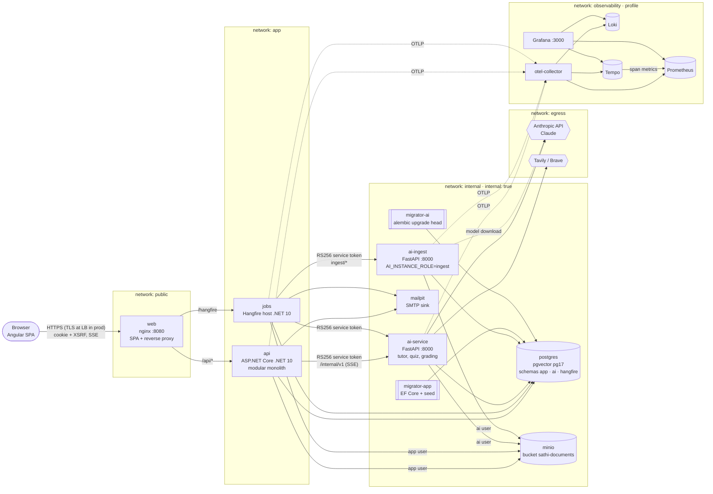
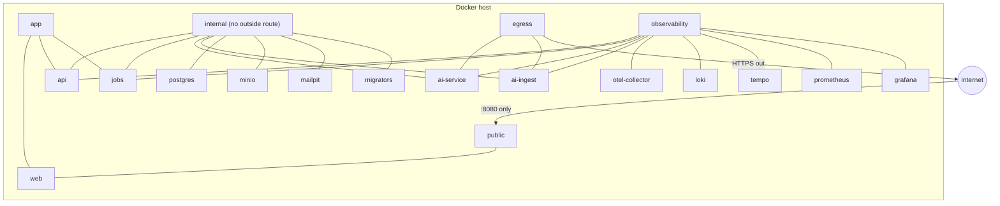
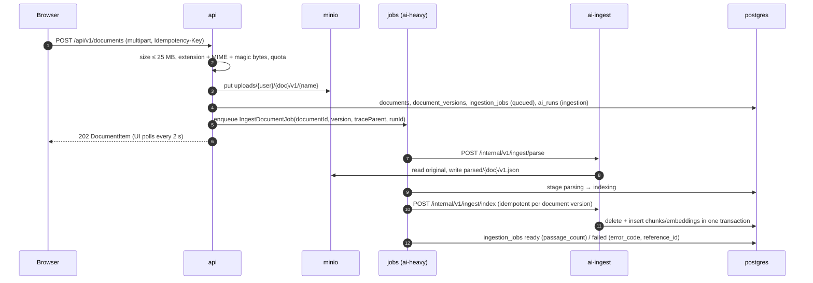
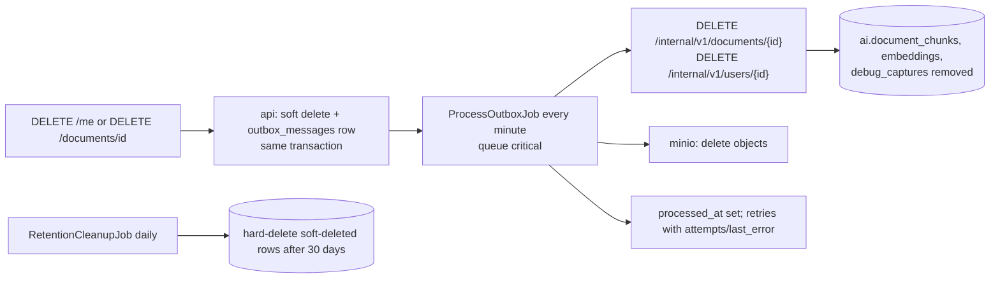

# Sathi — Architecture overview

Sathi is an adaptive AI tutor: students read lessons, ask a tutor that answers from course material, their own notes and (optionally) the web with citations, practise with quizzes, and get a revision schedule driven by a per-concept mastery model. Instructors manage content, share courses through classes and review uncertain AI grading; admins manage users and roles and trace any failed AI run from a reference ID. Learners under 18 need verifiable guardian consent (Release 2, contracts §11).

The binding details (ports, config keys, schemas, APIs, events, error codes, log fields) are in [contracts.md](contracts.md). Decisions and their trade-offs are in [../decisions](../decisions/README.md). Threats and mitigations are in [threat-model.md](threat-model.md).

## 1. Containers



| Container | Owns | Never does |
| --- | --- | --- |
| `web` | Static Angular build, edge headers (CSP, request ID, `traceparent`), coarse rate limits, SSE pass-through | Business logic, auth decisions |
| `api` | Users, roles, staff invites, guardian consent, courses (visibility, co-instructors), classes, class invites and join codes, lessons, conversations/messages (incl. cancel), documents metadata, quizzes, grading records, mastery, revision cards, recommendations, quotas, audit events, the AI run ledger (`ai_runs`, `ai_run_steps`) | Call an LLM directly, read the `ai` schema |
| `jobs` | Hangfire queues `critical` / `default` / `ai-heavy`, recurring jobs (incl. `RecoverStaleStreamsJob`), outbox delivery, dashboard (Admin only) | Serve public API traffic |
| `ai-service` | Verifying RS256 service tokens (public keys only), prompting, LLM calls, retrieval (vector + FTS + RRF), web search, quiz generation, grading assistance, stateless mastery maths, model/retrieval/search run logs, evaluation | Authenticate end users, read the `app` schema, accept retrieval scope from the request body |
| `ai-ingest` | Same image, used only for parse/index so heavy ingestion cannot slow live chat | Live tutor traffic |
| `postgres` | One database `sathi`, three schemas, one role each ([contracts §3](contracts.md#3-database)) | Be reachable from outside `internal` |
| `minio` | Uploaded originals (`uploads/...`), lesson files (`lessons/...`) and parsed JSON (`parsed/...`); users and policies created by `minio-init` — `api`/`jobs` use the app user, `ai-service`/`ai-ingest` the AI user ([ADR-0016](../decisions/0016-per-service-object-storage-credentials.md)) | Public buckets; root credentials in applications |

Startup order is enforced by Compose: `postgres` healthy → `minio-init`, `migrator-app`, `migrator-ai` complete → `ai-service` / `ai-ingest` healthy → `api` / `jobs`. Migrations never run at application start.

## 2. Networks



- Only `web:8080` is published by `compose.yaml`. `compose.override.yaml` (dev) additionally publishes Postgres, MinIO, Mailpit, the AI service, Prometheus and Grafana on `127.0.0.1`; containers that are only on `internal` cannot publish ports, so those join a dev-only `devhost` bridge.
- `internal` has `internal: true`: Postgres, MinIO, Mailpit and the migrators have no route to the internet.
- `ai-service` / `ai-ingest` get outbound HTTPS through `egress` (LLM, search, model download). `api` / `jobs` reach an external SMTP relay through `app` in production.
- Network isolation is the **second** layer; the first is the RS256 service token (the AI side can verify but not mint, [ADR-0015](../decisions/0015-rs256-service-tokens.md)), per-schema DB roles and per-service storage users.

## 3. Data flows

### 3.1 Tutor chat (live, never a job)

```mermaid
sequenceDiagram
    autonumber
    participant B as Browser
    participant W as web (nginx)
    participant A as api
    participant DB as postgres (app)
    participant AI as ai-service
    participant AIDB as postgres (ai)
    participant L as Claude / search
    B->>W: POST /api/v1/conversations/{id}/messages/stream<br/>traceparent, X-XSRF-TOKEN, Idempotency-Key
    W->>A: + X-Request-Id, X-Forwarded-*, unbuffered
    A->>DB: auth, ownership, quota; insert user msg + assistant msg (streaming); insert ai_runs
    A-->>B: event: start {runId, referenceId}
    A->>AI: POST /internal/v1/tutor/stream (Bearer service token with rscope)
    AI->>AIDB: hybrid retrieval filtered by rscope in SQL, write retrieval_runs
    AI-->>A: status retrieving / searching_web / generating
    opt webSearch
      AI->>L: SearchProvider (topic-only query)
    end
    AI->>L: LlmProvider stream
    AI-->>A: token … citation … done {steps, run}
    A-->>B: relayed events (ping every 15 s)
    AI->>AIDB: model_runs, search_runs
    A->>DB: final content, citations, status, ai_run_steps, usage_records
    Note over A: keeps consuming upstream even if the browser disconnects (180 s budget)
```

Before step 3 the API checks that the learner may see the course (§3.5); `rscope.course_ids` in the service token is built from the same rule, so retrieval can never reach a private course the learner has no class for.

**Stop and recovery** ([ADR-0017](../decisions/0017-tutor-cancellation-and-stale-stream-recovery.md)): `POST /conversations/{id}/messages/{messageId}/cancel` cancels the run in the API's in-process registry — the upstream request is aborted, the AI service stops the LLM stream (`finish_reason=cancelled`), the partial text is saved as `cancelled` and usage is recorded for generated tokens. A message still `streaming` after `Tutor:StaleStreamMinutes` (3) — e.g. after an API crash — is marked `failed` with `STREAM_INTERRUPTED` when read and by `RecoverStaleStreamsJob` (every 5 minutes).

### 3.2 Document ingestion



Retries: 3 attempts (10 s / 60 s / 300 s). Re-running the same job never duplicates chunks (unique `document_id, document_version, chunk_index`, delete-then-insert).

### 3.3 Quiz, grading and mastery

1. `POST /attempts/{id}/answers`: MCQ graded instantly in .NET; mastery updated via `POST /internal/v1/mastery/update`; revision card updated (SM-2).
2. Short answer: `grading_results` row `pending` → `GradeAnswerJob` (queue `critical`) → `POST /internal/v1/grade` (answer passed as quoted data) → confidence ≥ `Grading__AutoAcceptConfidence` ⇒ `auto_accepted`, else `needs_review` (logged `GRADING_LOW_CONFIDENCE`, metric `sathi_grading_routed_total{route}`) → instructor queue.
3. Attempt complete → recommendations recomputed (inline, plus `RecomputeRecommendationsJob`).

### 3.4 Deletion (outbox)



Backups keep deleted data until they age out; see [../runbooks/backup-restore.md](../runbooks/backup-restore.md). A guardian's `declined`/`withdrawn` decision for a minor runs the same `user.deleted` path.

### 3.5 Roles, classes and course access (Release 2)

Roles ([ADR-0013](../decisions/0013-roles-self-registration-student-only-staff-invites.md)): self-registration creates a **Student**; Admins grant **Instructor**/**Admin** on the Users page or by a staff invite (email-bound link, optionally attached to a course). Role claims are re-validated every minute (security stamp).

Course access ([ADR-0012](../decisions/0012-course-access-public-private-courses-and-classes.md)): a student sees a published course when it is `public` **or** they are an active member of a non-archived class of it; otherwise every course endpoint returns 404.

```mermaid
sequenceDiagram
    autonumber
    participant Ad as Admin
    participant I as Instructor
    participant S as Student
    participant A as api
    participant M as Mailpit / SMTP
    Ad->>A: POST /admin/staff-invites {email, role: Instructor, courseId?}
    A->>M: invite link /auth/register?staffInvite=token
    I->>A: register (same email) with staffInviteToken → roles Student + Instructor
    I->>A: POST /instructor/courses {visibility: private} (creator = owner)
    I->>A: POST /instructor/courses/{id}/classes {name} → join code XXXX-XXXX
    alt join code or link
      S->>A: POST /classes/join {code}
    else email invite
      I->>A: POST /instructor/classes/{id}/invites {emails}
      A->>M: /join/{token} (14 days, one per email)
      S->>A: POST /classes/invites/{token}/accept (signed in with the invited email)
    end
    A->>A: class_members row + enrolment (idempotent), activeCourseId if empty
    S->>A: GET /courses → course visible; tutor rscope includes it
```

Under-18 registration ([ADR-0014](../decisions/0014-under-18-learners-verifiable-guardian-consent.md)): `dateOfBirth` + `guardianEmail` → verification email to the learner and consent email (`/consent/{token}`) to the guardian; sign-in waits for `granted`; `declined`/`withdrawn` deletes the learner through the outbox.

## 4. Data ownership

| Data | Owner (writes) | Store | Retention |
| --- | --- | --- | --- |
| Identity, courses, classes, invites, conversations, messages, quizzes, mastery, audit | `api` / `jobs` (role `sathi_app`) | `app` schema | Messages until user deletion (+30 d purge); audit long |
| Guardian consent records | `api` | `app.guardian_consents` | Long (proof of consent; period pending legal review) |
| Chunks, embeddings, model/retrieval/search runs, evaluation | `ai-service` (role `sathi_ai`) | `ai` schema | Chunks follow document lifecycle; run metadata 90 d |
| Debug captures (full prompts) | `ai-service`, only when enabled by an Admin | `ai.debug_captures` | 72 h |
| Job state | Hangfire (role `sathi_hangfire`) | `hangfire` schema | Hangfire expiry (days); permanent record is `app.ai_runs` |
| Files | `api` (originals, app user), `ai-ingest` (parsed, AI user) | MinIO `sathi-documents` | Until document deletion (non-current versions: see threat model backlog) |
| Logs / traces / metrics | all services via OTLP | Loki / Tempo / Prometheus | Per environment, see [logging.md](logging.md#7-retention-and-sampling) |

No foreign keys cross schemas; cross-schema IDs are opaque UUIDs and the ledger joins on `run_id`.

## 5. Correlation in one picture

```
browser traceparent 00-7f3a91c2…-…-01 ──► nginx (X-Request-Id, access log trace_id)
   ──► api span (ai_runs.trace_id, reference_id = 7F3A91C2) ──► ai-service span (model_runs.trace_id)
   ──► Hangfire job args traceParent ──► jobs span ──► ai-ingest span
UI shows "Reference 7F3A-91C2"  →  Admin /admin lookup  →  Grafana Loki {..} | trace_id=~"(?i)^7f3a91c2.*"  →  Tempo trace
```

Walk-through: [../runbooks/debugging.md](../runbooks/debugging.md).
